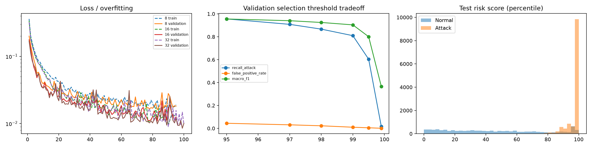
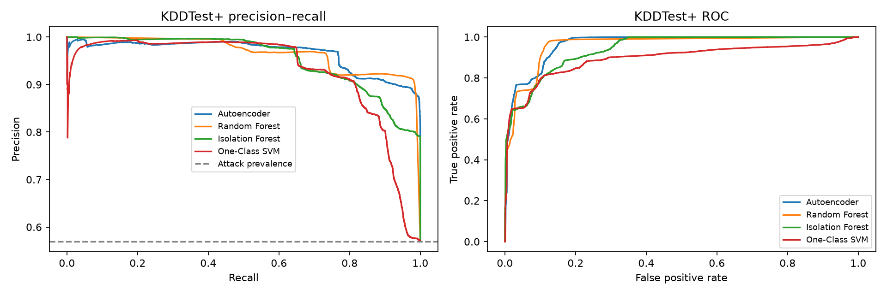
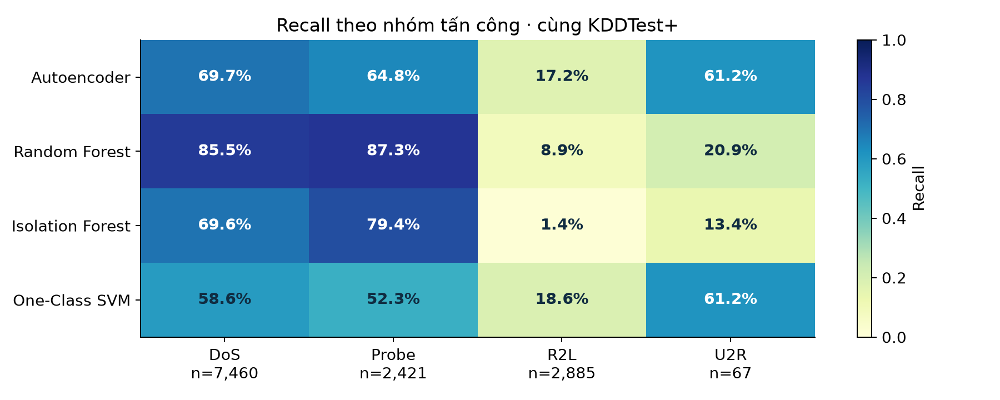
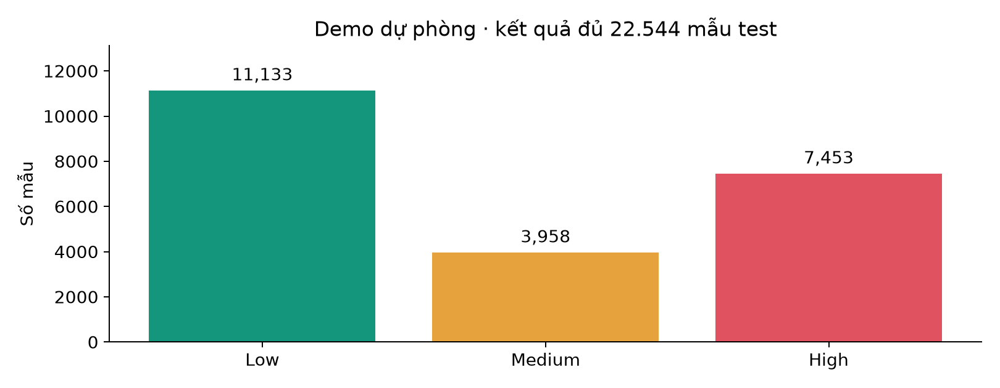

# Xây dựng mô hình Autoencoder phát hiện và chấm điểm rủi ro bất thường trên lưu lượng mạng

**Đánh giá trên NSL-KDD · Báo cáo thực nghiệm cuối kỳ**

## Tóm tắt

Đề tài xây dựng Autoencoder phát hiện bất thường và chấm điểm lưu lượng NSL-KDD. Mô hình chỉ học từ Normal train; MSE tái tạo được hiệu chuẩn thành điểm phân vị 0–100 và ba mức cảnh báo. Latent 16 được chọn trong ba thử nghiệm bằng AP validation. Trên KDDTest+, AE đạt AP 0,9662, recall Attack 56,93%, FPR 1,51%; chưa đáp ứng đồng thời recall cao và cảnh báo nhầm thấp. Web demo Streamlit hỗ trợ upload, kiểm tra schema, biểu đồ và tải CSV.

## 1. Bài toán và phạm vi

Mục tiêu gồm phân loại Normal/Attack, tạo điểm bất thường dễ đọc, phân tích DoS/Probe/R2L/U2R và so sánh ba baseline. Đầu vào là bản ghi kết nối NSL-KDD, không phải packet capture hoặc luồng mạng trực tiếp. Điểm rủi ro không đại diện xác suất tấn công, mức thiệt hại hoặc nhãn mức độ nguy hiểm đã được kiểm chứng.

## 2. Dữ liệu và preprocessing

KDDTrain+ có 125.973 mẫu, KDDTest+ có 22.544 mẫu. 41 đặc trưng gồm 38 numeric và ba categorical: protocol_type, service, flag. Loại nhãn và difficulty khỏi đầu vào. Split train/validation 80/20, stratify nhị phân, seed 42: 100.778/25.195 mẫu. Chỉ 53.874 Normal train được dùng fit OneHotEncoder/StandardScaler và huấn luyện AE, IF, OCSVM. Đầu ra có 77 chiều; category chưa thấy mã hóa block 0. Test có 1.343 dòng service lạ và hai dòng flag lạ; giới hạn này được cảnh báo trên dashboard. Dữ liệu gốc được kiểm tra hash theo mirror đã pin.

## 3. Thiết kế thực nghiệm và tránh rò rỉ

Validation chia 40/30/30, stratify nhị phân: 5.388 Normal early stopping, 4.040 Normal calibration và 7.559 mẫu selection có cả hai lớp. Chọn epoch bằng early-stopping loss; chọn latent bằng AP selection; chọn threshold từ phân vị Normal calibration, đánh giá macro-F1/FPR trên selection. Mục tiêu FPR selection <=1%; không bảo đảm FPR test <=1%. Có sử dụng nhãn Attack validation để chọn cấu hình/ngưỡng, nhưng không dùng Attack train để fit AE. Test đã được xem qua các giai đoạn trước; không gọi đây là đánh giá mù trên tập chưa từng quan sát. Không dùng test để chọn lại cấu hình trong lần tìm kiếm này.

## 4. Autoencoder và risk scoring

Encoder 77→64→32→16; decoder 16→32→64→77. ReLU ở hidden, bottleneck/output linear phù hợp StandardScaler không bị chặn [0,1]. Adam lr=0,001, batch 256, weight decay=1e-5, clip norm=5, tối đa 100 epoch, patience=12. Score gốc là trung bình bình phương sai số trên 77 đặc trưng. Risk Score = 100 × số Normal calibration có MSE <= MSE mẫu / 4.040. Điểm bão hòa ngoài miền tham chiếu, nên giữ MSE gốc để so sánh các mẫu cùng điểm 100. Low: MSE<0,02376216; Medium: từ ngưỡng đó đến dưới 0,10899014; High: từ 0,10899014 trở lên. High là Attack; Low/Medium là Normal. Dùng giá trị chưa làm tròn để quyết định.

## 5. Tối ưu latent, threshold và overfitting

AP selection cho latent 8/16/32 lần lượt 0,972914 / 0,978826 / 0,978095. Chọn 16, checkpoint epoch 83/95 epoch thực chạy. Latent 32 có MSE Normal thấp hơn nhưng AP không cao nhất; tái tạo tốt hơn không tự bảo đảm phát hiện tốt hơn. Chênh AP 16–32 nhỏ, chưa có nhiều seed để kết luận khác biệt có ý nghĩa. P95 có recall selection 95,59% nhưng FPR 4,45%; P99 đạt recall 80,96%, FPR 0,99%, được chọn theo ngân sách. Ở checkpoint 16 tốt nhất, train MSE=0,01338, stop MSE=0,01088; loss stop cuối cao hơn tốt nhất 15,4%, nên đã khôi phục checkpoint tốt nhất. Dao động không đủ chứng minh overfitting đã bị loại bỏ. Cấu hình 32 chạm 100 epoch, chưa kết luận hội tụ hoàn toàn.

## 6. So sánh bốn mô hình

RF dùng toàn bộ 100.778 mẫu train có nhãn, 300 cây, class_weight=balanced. IF dùng Normal train, 300 cây, max_samples=256 mỗi cây. OCSVM dùng toàn bộ Normal train, RBF gamma=scale, nu=0,05; kiểm tra hội tụ đạt. Cùng preprocessing, calibration/selection và test. Ngưỡng baseline chọn trên P97/P98/P99/P99.5/P99.9 với cùng quy tắc macro-F1/FPR. RF có giám sát nên không cùng giả định học với ba mô hình Normal-only. Baseline chưa được tối ưu nhiều cấu hình như AE; ngân sách thực nghiệm không ngang nhau.

| Mô hình | Accuracy | Precision | Recall | Macro-F1 | FPR | AP |
| --- | --- | --- | --- | --- | --- | --- |
| Autoencoder | 74.83% | 98.03% | 56.93% | 0.7458 | 1.51% | 0.9662 |
| Random Forest | 80.71% | 96.94% | 68.27% | 0.8069 | 2.85% | 0.9640 |
| Isolation Forest | 74.25% | 98.11% | 55.84% | 0.7395 | 1.42% | 0.9539 |
| One-Class SVM | 70.36% | 98.92% | 48.45% | 0.6966 | 0.70% | 0.9296 |

## 7. Phân tích từng nhóm tấn công

DoS: AE phát hiện 5.201/7.460 (69,72%), bỏ sót 2.259. Probe: 1.569/2.421 (64,81%), bỏ sót 852. R2L: 495/2.885 (17,16%), bỏ sót 2.390; đây là điểm yếu rõ nhất của AE tại ngưỡng hiện tại. U2R: 41/67 (61,19%), bỏ sót 26; một mẫu đã làm thay đổi recall khoảng 1,49 điểm phần trăm, nên không diễn giải quá mức. RF đạt recall DoS/Probe cao hơn (85,47%/87,28%) nhưng R2L/U2R thấp (8,94%/20,90%). IF rất yếu ở R2L (1,39%). OCSVM có R2L 18,65% và FPR thấp nhất, nhưng recall tổng chỉ 48,45%. Không có mô hình tốt nhất đồng thời trên mọi nhóm và mọi tiêu chí. Sự giống nhau giữa mẫu tấn công và Normal là một giả thuyết giải thích cần kiểm chứng thêm, không phải nguyên nhân đã được chứng minh từ các bảng này.

| Nhóm | Số mẫu | AE phát hiện | AE bỏ sót | AE recall |
| --- | --- | --- | --- | --- |
| DoS | 7460 | 5201 | 2259 | 69.72% |
| Probe | 2421 | 1569 | 852 | 64.81% |
| R2L | 2885 | 495 | 2390 | 17.16% |
| U2R | 67 | 41 | 26 | 61.19% |

## 8. Kiểm thử và dashboard

21 kiểm thử unit/UI đạt. Kiểm thử tích hợp đã dựng lại preprocessing từ raw, đối chiếu mọi ma trận và nhãn, kiểm tra validation rời nhau, nạp cả bốn estimator và tái lập toàn bộ dự đoán test. Đường raw CSV→schema→AE→MSE→Risk Score→mức cảnh báo khớp 22.544 mẫu. Notebook có đủ output đã thực thi, không có lỗi. Kiểm thử cuối không huấn luyện lại các mô hình hoặc tìm kiếm siêu tham số. Browser demo đã xử lý full test và endpoint tải CSV trả HTTP 200 đủ 22.544 dòng. Dashboard giới hạn 20 MB/100.000 dòng, kiểm tra tên/thứ tự cột, dữ liệu thiếu, giá trị hữu hạn và miền cơ bản; hỗ trợ có/không header, lọc cảnh báo, biểu đồ và download toàn bộ dữ liệu theo thứ tự gốc.

## 9. Kết luận và hướng phát triển

Đã hoàn thành pipeline tái lập, mô hình lưu/nạp, chấm điểm ba mức, so sánh và demo. AE có AP/ROC-AUC cao nhất trong lần chạy; RF có recall/macro-F1 cao nhất nhưng được dùng nhãn train; OCSVM có FPR thấp nhất. AE vẫn bỏ sót 5.527 Attack, cảnh báo nhầm 147 Normal; FPR test 1,51% vượt ngân sách validation 1%. Không tuyên bố mô hình đủ cho production. Hướng tiếp theo: nhiều seed, phân tích false negatives theo đặc trưng, log-transform/robust scaling có validation riêng, cân bằng trọng số MSE numeric và one-hot, baseline tuning với cùng ngân sách, đánh giá trên dữ liệu mạng mới. Mọi thay đổi cần tập đánh giá mới hoặc protocol đánh giá phù hợp, tránh tiếp tục tối ưu vào test hiện tại.

## Tài liệu tham khảo và nguồn tái lập

M. Tavallaee, E. Bagheri, W. Lu, A. Ghorbani, “A Detailed Analysis of the KDD CUP 99 Data Set”, CISDA 2009. Mirror: https://github.com/Jehuty4949/NSL_KDD, commit 27bbbdf5c5cccf9970b8b6037a0f19dc09c5a0a9. Số liệu trong báo cáo lấy từ reports/model_comparison/metrics.json và reports/risk_optimization/summary.json; audit nằm trong deliverables/pipeline_audit.json. Phiên bản chính xác trong requirements-lock.txt.
