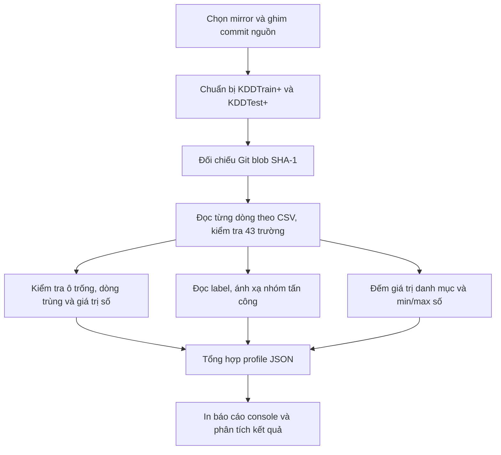
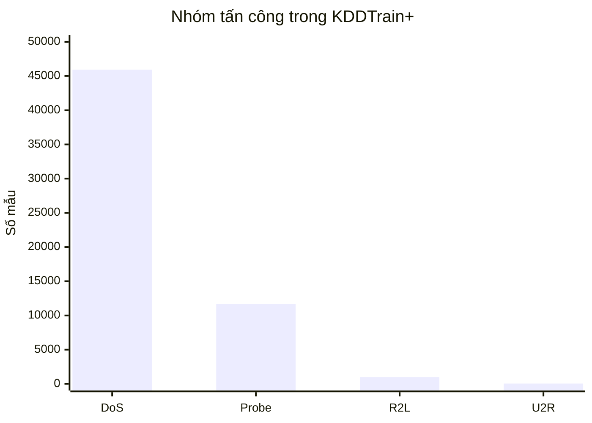
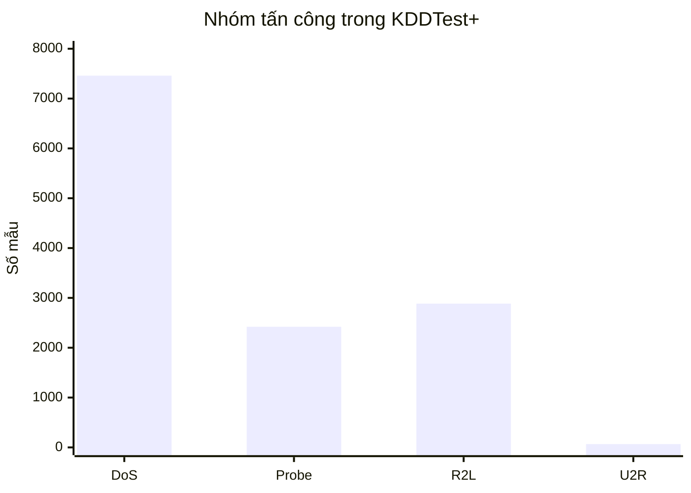

# BÁO CÁO GIAI ĐOẠN 2

## Chuẩn bị và khảo sát dữ liệu NSL-KDD

| Thông tin | Nội dung |
|---|---|
| Đề tài | Phát hiện và chấm điểm rủi ro bất thường mạng bằng Autoencoder |
| Giai đoạn | Giai đoạn 2 — Chuẩn bị và khảo sát dữ liệu |
| Bộ dữ liệu | NSL-KDD |
| Phạm vi thực hiện | Chuẩn bị, xác minh nguồn, kiểm tra cấu trúc và mô tả dữ liệu |
| Trạng thái | Hoàn thành khảo sát; chưa tiền xử lý để huấn luyện mô hình |

---

## 1. Mục đích của giai đoạn

Trước khi huấn luyện mô hình, cần biết dữ liệu đến từ đâu, mỗi dòng biểu diễn
điều gì, nhãn được tổ chức ra sao và dữ liệu có lỗi cấu trúc hay không. Giai
đoạn này tạo một căn cứ có thể kiểm tra lại cho những quyết định đó.

Các câu hỏi cần trả lời:

1. Hai tệp train và test có đúng nguồn, đầy đủ và đọc được không?
2. Mỗi bản ghi có đúng số trường dự kiến không; có ô trống, dòng trùng hay
   giá trị số bất thường không?
3. Dữ liệu có bao nhiêu mẫu bình thường, tấn công và từng nhóm tấn công?
4. Những đặc trưng nào là dạng danh mục, và tập test có giá trị danh mục mới
   không xuất hiện trong train hay không?
5. Những thông tin nào được phép đưa vào mô hình, thông tin nào chỉ phục vụ
   gán nhãn hoặc phân tích?

Giai đoạn này **không** huấn luyện Autoencoder hay các baseline, không mã hóa
đặc trưng, không chuẩn hóa dữ liệu và không chọn ngưỡng phát hiện.

## 2. Nguồn và cách tổ chức dữ liệu

Trang dữ liệu của Canadian Institute for Cybersecurity hiện thông báo dữ liệu
không còn được cung cấp trực tiếp. Dự án sử dụng bản mirror công khai
[`Jehuty4949/NSL_KDD`](https://github.com/Jehuty4949/NSL_KDD), ghim ở commit
`27bbbdf5c5cccf9970b8b6037a0f19dc09c5a0a9`.

Hai tệp dữ liệu gốc được đặt trong `data/raw/`:

| Tệp | Vai trò theo NSL-KDD | Dung lượng | Số bản ghi |
|---|---|---:|---:|
| `KDDTrain+.txt` | Tập train được cung cấp cùng bộ dữ liệu | 19.109.424 byte | 125.973 |
| `KDDTest+.txt` | Tập test được cung cấp cùng bộ dữ liệu | 3.441.513 byte | 22.544 |

Mỗi dòng là một kết nối mạng đã được biểu diễn thành các trường, không có hàng
tiêu đề trong tệp. Dấu `+` trong tên tệp là một phần tên chính thức của hai
phiên bản dữ liệu này.

### 2.1. Xác minh nguồn

Script tính Git blob SHA-1 của tệp và so sánh với giá trị đã ghi cùng commit
nguồn. Cả hai giá trị đều khớp:

| Tệp | Git blob SHA-1 đã xác minh |
|---|---|
| `KDDTrain+.txt` | `20002897492adc110190a10509aa694f26f7f308` |
| `KDDTest+.txt` | `b30e89605285a5ccd8cf8fd38dba72906c20d3dd` |

Việc ghim commit và kiểm tra hash giúp có thể nhận biết nếu tệp tải về khác
phiên bản đã chọn hoặc nội dung bị thay đổi. Khi khảo sát, script chỉ đọc dữ
liệu raw và ghi profile vào `reports/`. Nếu chạy với `--download`, script chỉ
ghi tệp vào `data/raw/` sau khi hash đã khớp; không chỉnh sửa các tệp đã có.

## 3. Cấu trúc một bản ghi và ý nghĩa các trường

Mỗi dòng có **43 trường** theo thứ tự:

```text
41 đặc trưng mô tả kết nối, label, difficulty
```

### 3.1. 41 đặc trưng đầu vào dự kiến

Các đặc trưng mô tả kết nối và thống kê lưu lượng. Có thể nhóm để dễ hiểu:

| Nhóm | Trường | Ý nghĩa khái quát |
|---|---|---|
| Thông tin kết nối | `duration`, `protocol_type`, `service`, `flag` | Thời lượng, giao thức, dịch vụ và trạng thái kết nối. |
| Lưu lượng hai chiều | `src_bytes`, `dst_bytes` | Số byte truyền từ nguồn đến đích và từ đích về nguồn. |
| Dấu hiệu nội dung/kết nối | `land`, `wrong_fragment`, `urgent`, `hot`, `num_failed_logins`, `logged_in`, `num_compromised`, `root_shell`, `su_attempted`, `num_root`, `num_file_creations`, `num_shells`, `num_access_files`, `num_outbound_cmds`, `is_host_login`, `is_guest_login` | Cờ trạng thái hoặc số lượng các dấu hiệu, thao tác, phiên đăng nhập và hoạt động được mã hóa trong bộ dữ liệu. |
| Thống kê kết nối gần đây | `count`, `srv_count`, `serror_rate`, `srv_serror_rate`, `rerror_rate`, `srv_rerror_rate`, `same_srv_rate`, `diff_srv_rate`, `srv_diff_host_rate` | Tần suất, tỷ lệ lỗi và mức lặp lại dịch vụ/host trong cửa sổ thống kê. |
| Thống kê theo host đích | `dst_host_count`, `dst_host_srv_count`, `dst_host_same_srv_rate`, `dst_host_diff_srv_rate`, `dst_host_same_src_port_rate`, `dst_host_srv_diff_host_rate`, `dst_host_serror_rate`, `dst_host_srv_serror_rate`, `dst_host_rerror_rate`, `dst_host_srv_rerror_rate` | Số lượng và tỷ lệ kết nối, dịch vụ, cổng nguồn và lỗi gắn với host đích. |

Trong 41 trường, ba trường danh mục là `protocol_type`, `service` và `flag`.
Các trường còn lại được công cụ khảo sát kiểm tra là giá trị số.

### 3.2. `label` và `difficulty`

- **`label`** là nhãn kết nối. `normal` biểu thị kết nối bình thường; các giá
  trị khác là tên kiểu tấn công, ví dụ `neptune` hoặc `nmap`. Script dùng nhãn
  này để thống kê và gom nhóm tấn công.
- **`difficulty`** là trường phụ do bộ dữ liệu cung cấp để mô tả độ khó phân
  loại của bản ghi trong NSL-KDD. Nó không phải nhãn tấn công, độ nghiêm trọng
  của sự cố, hay điểm rủi ro của Autoencoder.

Theo quy ước của đề tài, chỉ 41 đặc trưng được đưa vào mô hình. `label` được
dùng làm giá trị tham chiếu khi đánh giá; `difficulty` không được dùng làm
đầu vào mô hình.

## 4. Quy trình khảo sát



### 4.1. Kiểm tra cấu trúc và chất lượng

Với mỗi dòng, công cụ kiểm tra đủ 43 trường trước khi phân tích sâu. Các dòng
sai số trường được đếm là sai định dạng. Với những dòng đúng cấu trúc, công cụ
đếm ô trống và so sánh toàn dòng để tìm bản ghi trùng. Các trường số được
chuyển thử sang số hữu hạn; giá trị không chuyển được hoặc không hữu hạn được
ghi nhận là ô số lỗi.

Đây là kiểm tra cấu trúc và tính hợp lệ cơ bản; nó không chứng minh mọi giá
trị đều có ý nghĩa nghiệp vụ chính xác hoặc đại diện cho lưu lượng mạng hiện
đại.

### 4.2. Chuẩn hóa nhãn thành nhóm

Tên nhãn được bỏ khoảng trắng, chuyển chữ thường và bỏ dấu chấm cuối nếu có.
`normal` được giữ riêng; tên tấn công được gom theo taxonomy thành DoS,
Probe, R2L hoặc U2R. Nhãn ngoài danh sách được giữ là `unknown` để xem xét,
không tự gán vào nhóm khác.

| Nhóm | Ví dụ nhãn |
|---|---|
| DoS | `neptune`, `back`, `smurf` |
| Probe | `nmap`, `ipsweep`, `portsweep` |
| R2L | `guess_passwd`, `warezclient`, `ftp_write` |
| U2R | `buffer_overflow`, `rootkit`, `perl` |

### 4.3. Thống kê đặc trưng

Đối với ba trường danh mục, công cụ thu thập tập giá trị quan sát được và tính
số loại riêng biệt (cardinality). Đối với đặc trưng số, công cụ ghi nhận
min/max và các giá trị không hợp lệ. Thống kê này mô tả dữ liệu hiện có; nó
chưa phải là phép biến đổi dữ liệu dùng cho mô hình.

## 5. Công cụ và tệp đầu ra

| Tệp | Vai trò trong giai đoạn |
|---|---|
| [`data/raw/KDDTrain+.txt`](../data/raw/KDDTrain%2B.txt) | Tệp dữ liệu train gốc; giữ nguyên. |
| [`data/raw/KDDTest+.txt`](../data/raw/KDDTest%2B.txt) | Tệp dữ liệu test gốc; giữ nguyên và dành cho đánh giá cuối. |
| [`data/raw/README.md`](../data/raw/README.md) | Ghi nguồn, phiên bản đã ghim, cách tải và trích dẫn bộ dữ liệu. |
| [`scripts/inspect_nsl_kdd.py`](../scripts/inspect_nsl_kdd.py) | Tải/xác minh dữ liệu, khảo sát từng tệp và in báo cáo dễ đọc. |
| [`reports/nsl_kdd_data_profile.json`](../reports/nsl_kdd_data_profile.json) | Lưu kết quả chi tiết dạng máy đọc được, gồm số dòng, nhãn, nhóm, lỗi, cardinality và min/max. |
| [`tests/test_inspect_nsl_kdd.py`](../tests/test_inspect_nsl_kdd.py) | Kiểm thử ánh xạ nhãn, phát hiện dữ liệu lỗi và định dạng tóm tắt. |
| [`docs/bao-cao-tien-do.md`](./bao-cao-tien-do.md) | Tổng hợp tiến độ dự án theo các giai đoạn. |

### 5.1. Các phần code đáng chú ý

Trong `inspect_nsl_kdd.py`:

- `FEATURES`, `EXPECTED_COLUMNS`, `NUMERIC_FEATURES`: mô tả schema 41 đặc
  trưng và tổng 43 trường.
- `ATTACK_GROUPS` và `classify_label()`: định nghĩa và áp dụng ánh xạ nhãn.
- `github_blob_sha()` và `download_dataset()`: xác minh phiên bản và tải dữ
  liệu an toàn trước khi lưu.
- `profile_file()`: đọc từng dòng, kiểm tra lỗi và tích lũy thống kê.
- `print_summary()` và `print_visual_summary()`: trình bày thống kê, thanh
  ASCII và trạng thái kiểm tra trong terminal.
- `main()`: điều phối tham số dòng lệnh, đọc hai tệp, xác minh hash, so sánh
  category train/test và ghi JSON.

Chương trình dùng thư viện chuẩn Python; không cần cài thư viện học máy để
chạy bước khảo sát này.

## 6. Kết quả khảo sát

### 6.1. Số lượng và tỷ lệ lớp

| Tập | Tổng số mẫu | Normal | Attack |
|---|---:|---:|---:|
| Train | 125.973 | 67.343 (53,5%) | 58.630 (46,5%) |
| Test | 22.544 | 9.711 (43,1%) | 12.833 (56,9%) |

Hai tập có tỷ lệ bình thường/tấn công khác nhau. Vì vậy, không thể chỉ nhìn
vào một con số accuracy để kết luận mô hình tốt; khi đánh giá cần xem các chỉ
số theo lớp, tỷ lệ cảnh báo nhầm và chỉ số theo nhóm.

### 6.2. Phân bố nhóm tấn công

| Nhóm | Train | Test |
|---|---:|---:|
| DoS | 45.927 | 7.460 |
| Probe | 11.656 | 2.421 |
| R2L | 995 | 2.885 |
| U2R | 52 | 67 |





DoS là nhóm lớn nhất trong cả hai tập. U2R có rất ít mẫu; R2L cũng ít hơn
nhiều trong train so với DoS và Probe. Khi trình bày chỉ số theo nhóm cần ghi
số mẫu hỗ trợ và diễn giải thận trọng. Không cân bằng hoặc lấy mẫu lại tập
test vì sẽ làm thay đổi phân phối đánh giá.

### 6.3. Kiểm tra chất lượng

| Kiểm tra | Train | Test |
|---|---:|---:|
| Dòng có đủ 43 trường | 125.973/125.973 | 22.544/22.544 |
| Dòng sai định dạng | 0 | 0 |
| Ô trống | 0 | 0 |
| Dòng trùng | 0 | 0 |
| Ô số không hợp lệ | 0 | 0 |
| Nhãn chưa ánh xạ | 0 | 0 |
| Hash khớp nguồn đã ghim | Có | Có |

### 6.4. Đặc trưng danh mục

| Trường | Số loại trong train | Số loại trong test |
|---|---:|---:|
| `protocol_type` | 3 | 3 |
| `service` | 70 | 64 |
| `flag` | 11 | 11 |

Đối chiếu tập giá trị cho thấy không có category trong test vắng mặt ở train.
Tuy vậy, pipeline sau này vẫn cần xử lý category chưa biết để không lỗi khi
gặp dữ liệu mới hoặc dữ liệu triển khai khác bộ benchmark.

## 7. Cách chạy và đọc kết quả

Từ thư mục gốc dự án trong PowerShell:

```powershell
.\.venv\Scripts\python.exe scripts\inspect_nsl_kdd.py
```

Nếu cần tải lại khi hai tệp chưa có:

```powershell
.\.venv\Scripts\python.exe scripts\inspect_nsl_kdd.py --download
```

Khi chạy thành công, công cụ in số liệu tóm tắt và biểu đồ thanh dạng ký tự
`#` trong terminal, đồng thời ghi profile JSON vào
`reports/nsl_kdd_data_profile.json`. Đây không phải ảnh PNG/SVG. Các sơ đồ
Mermaid trong tài liệu cần xem bằng Markdown Preview hỗ trợ Mermaid.

Kiểm thử công cụ:

```powershell
.\.venv\Scripts\python.exe -m unittest discover -s tests -p "test_*.py" -v
```

## 8. Ý nghĩa kết quả và các lưu ý khi dùng dữ liệu

1. **Không chỉnh sửa dữ liệu raw.** Nếu cần biến đổi, ghi dữ liệu đã xử lý vào
   vị trí khác để có thể tái lập và đối chiếu với nguồn.
2. **Không đưa `label` và `difficulty` vào đầu vào.** `label` là đáp án tham
   chiếu; `difficulty` là thông tin phụ của dataset, không phải điểm rủi ro
   của mô hình.
3. **Giữ `KDDTest+` tách biệt.** Khi xây dựng pipeline, tách validation từ
   `KDDTrain+`; chỉ fit encoder/scaler trên phần train. Không dùng test để
   điều chỉnh mô hình, ngưỡng hoặc phép biến đổi.
4. **Tôn trọng mất cân bằng lớp.** Báo cáo số mẫu theo nhóm; kết quả R2L/U2R
   cần được đọc cùng số lượng mẫu và các chỉ số phù hợp, không chỉ accuracy.
5. **Hash xác nhận tính toàn vẹn, không xác nhận tính đại diện.** Tệp đúng
   nguồn vẫn có thể có giới hạn so với lưu lượng mạng hiện đại.
6. **NSL-KDD là benchmark.** Kết quả trên bộ dữ liệu này không tự chứng minh
   khả năng phát hiện ngoài môi trường thực tế.

## 9. Kết luận giai đoạn

Giai đoạn 2 đã chuẩn bị và xác minh hai tệp NSL-KDD, làm rõ schema, kiểm tra
các lỗi dữ liệu cơ bản, ánh xạ nhãn tấn công, thống kê phân phối và lưu kết
quả để có thể tái sử dụng. Kết quả cho thấy dữ liệu có cấu trúc nhất quán
theo các kiểm tra đã thực hiện, nhưng có mất cân bằng đáng kể giữa các nhóm
tấn công.

Phần đã hoàn thành là **khảo sát dữ liệu**. Tách validation, mã hóa danh mục,
chuẩn hóa đặc trưng và huấn luyện mô hình thuộc các bước triển khai tiếp theo,
không được tính là kết quả của giai đoạn này.

## Tài liệu tham khảo dữ liệu

> M. Tavallaee, E. Bagheri, W. Lu, and A. Ghorbani, “A Detailed Analysis of the
> KDD CUP 99 Data Set,” Second IEEE Symposium on Computational Intelligence for
> Security and Defense Applications (CISDA), 2009.

Thông tin nguồn, phiên bản mirror và hướng dẫn trích dẫn được ghi tại
[`data/raw/README.md`](../data/raw/README.md).
