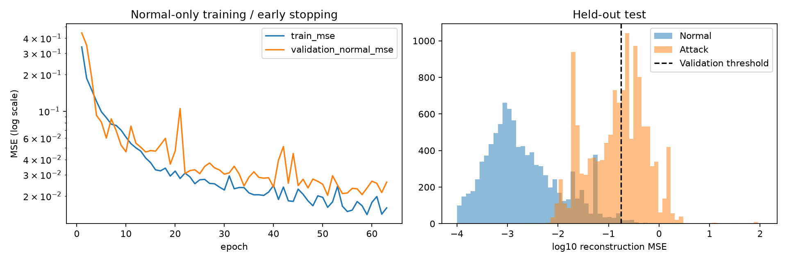

# Autoencoder phát hiện Normal/Attack

## Kết quả lần chạy đã kiểm chứng

Huấn luyện bằng 53.874 mẫu Normal, early stopping dùng 6.734 mẫu Normal validation,
calibration dùng 6.735 mẫu Normal validation. Dừng sau 63 epoch, chọn epoch 51.
MSE train của mô hình tốt nhất là 0,01628; MSE early stopping là 0,02026.
Ngưỡng P99 = **0,17633297775314696**, FPR calibration = **1,01%**.

| Chỉ số trên test (22.544 mẫu) | Giá trị |
|---|---:|
| Precision Attack | 98,65% |
| Recall Attack | 50,53% |
| F1 Attack | 0,6683 |
| Macro-F1 | 0,7088 |
| FPR Normal | 0,92% |
| ROC-AUC | 0,9630 |
| PR-AUC (average precision) | 0,9657 |

Confusion matrix: TN=9.622, FP=89, FN=6.348, TP=6.485.
Recall theo nhóm: DoS 66,94% (7.460 mẫu), Probe 47,75% (2.421 mẫu),
R2L 10,19% (2.885 mẫu), U2R 61,19% (67 mẫu).

Ở ngưỡng này mô hình ít báo nhầm nhưng còn bỏ sót gần một nửa tấn công và phần lớn
R2L. AUC cao không thay thế kết quả tại threshold vận hành. Không điều chỉnh ngưỡng
bằng kết quả test; nếu thử chính sách ngưỡng khác, phải xác định trên validation.
Nhóm U2R có ít mẫu nên kết quả cần được diễn giải thận trọng.



Đã kiểm tra: 7 unit tests đạt; load lại checkpoint cho cùng score;
suy luận từ file raw cho cùng score và nhãn với đánh giá test trên cả 22.544 dòng;
`pip check` không phát hiện xung đột. Chi tiết máy đọc được nằm trong
[metrics.json](../reports/autoencoder/metrics.json).

## Chạy trên Windows

Mở Terminal PowerShell ở thư mục project. Không cần activate môi trường:

```powershell
./.venv/Scripts/python.exe -m pip install -r requirements-lock.txt
./.venv/Scripts/python.exe scripts/train_autoencoder.py
./.venv/Scripts/python.exe scripts/predict_autoencoder.py --model-dir artifacts/models/autoencoder --output reports/autoencoder/predictions.csv
```

Nếu chưa có dữ liệu processed, chạy `scripts/prepare_nsl_kdd.py` trước.
Đường dẫn dùng dấu `/` để cũng chạy được trong Git Bash trên Windows.

Đọc kết quả dự đoán:

```powershell
Get-Content reports/autoencoder/predictions.csv -TotalCount 8
```

Chạy kiểm thử:

```powershell
./.venv/Scripts/python.exe -m unittest discover -s tests -p 'test_*.py' -v
```

## Thiết kế và giao thức

Code mô hình có thể tái sử dụng trong [autoencoder.py](../src/nsl_kdd/autoencoder.py).
Lệnh huấn luyện nằm trong [train_autoencoder.py](../scripts/train_autoencoder.py),
lệnh suy luận trong [predict_autoencoder.py](../scripts/predict_autoencoder.py).

- Encoder: 77 → 64 (ReLU) → 32 (ReLU) → 16 (linear).
- Decoder: 16 → 32 (ReLU) → 64 (ReLU) → 77 (linear).
- Đầu ra linear vì dữ liệu StandardScaler có thể âm hoặc vượt 1.
- Loss là MSE, Adam learning rate 0.001, weight decay 0.00001, batch 256;
  giới hạn gradient norm 5.0; tối đa 100 epoch, patience 12.
- CPU, 4 luồng, seed 42, deterministic algorithms. Seed tái lập trong cùng môi trường;
  không bảo đảm bitwise giữa mọi phiên bản/nền tảng.
- Chỉ mẫu Normal của train được dùng cập nhật trọng số.
- Chia đôi Normal validation bằng seed 42: phần early stopping chọn checkpoint có
  MSE nhỏ nhất; phần calibration độc lập tính P99. Không chọn epoch bằng calibration/test.
- Reconstruction error mỗi dòng là trung bình bình phương sai lệch trên toàn bộ 77
  đặc trưng. Float64 dùng khi tích lũy score để xử lý outlier lớn.
- `error >= threshold` → **Attack**, ngược lại → **Normal**. P99 nhằm FPR khoảng 1%
  trên Normal calibration; FPR test phải đo riêng, không bảo đảm giữ ở mức 1%.
- Không dùng nhãn Attack của validation để tối ưu ngưỡng. Metrics validation mang
  tính mô tả vì có cả dữ liệu early stopping/calibration; test giữ độc lập.

## Đầu ra

Thư mục `artifacts/models/autoencoder/` chứa:

- `model.pt`: state_dict, input dimension, thứ tự đặc trưng và threshold.
- `pipeline.joblib`: bản sao preprocessing đã fit để tránh dùng nhầm phiên bản.
- `preprocessing_metadata.json`, `config.json`: schema, cấu hình, phiên bản,
  hash dữ liệu/pipeline/mô hình và kết quả đánh giá.
- `validation_partition.npz`: row ID trong raw train của hai phần validation Normal.

Thư mục `reports/autoencoder/` chứa:

- `metrics.json`: confusion matrix (hàng là nhãn thật, cột là dự đoán; Normal/Attack),
  precision, recall, F1, macro-F1, FPR, ROC-AUC, PR-AUC theo average precision,
  số mẫu và tỷ lệ bị phát hiện theo từng nhóm. Với Normal, tỷ lệ này chính là FPR;
  với nhóm tấn công, tỷ lệ này là recall của nhóm.
- `history.csv`, `training_and_errors.png`: đường loss và phân bố score test.
- `validation_predictions.csv`, `test_predictions.csv`: nhãn thật, nhóm, MSE, dự đoán.
- `predictions.csv`: kết quả lệnh suy luận, gồm row_id, MSE, threshold, Normal/Attack.

Mỗi lần chạy ghi đè artifact/báo cáo của lần trước. Mô hình và pipeline là file
nhị phân được Git bỏ qua; cần giữ cả thư mục mô hình khi chuyển sang máy khác.
Chỉ nạp joblib từ nguồn tin cậy.

Lệnh suy luận nhận file NSL-KDD không header với 41 đặc trưng hoặc 43 cột gốc:

```powershell
./.venv/Scripts/python.exe scripts/predict_autoencoder.py --model-dir artifacts/models/autoencoder --input data/raw/KDDTest+.txt --output reports/autoencoder/my_predictions.csv
```

Không cần nhãn thật để suy luận; cột label/difficulty nếu có sẽ bị loại bỏ.
Score này đo bất thường, không phải xác suất tấn công. Chưa triển khai điểm rủi ro
0–100 hoặc ba mức rủi ro. Đặc trưng có đuôi dài và category lạ có thể ảnh hưởng lớn
đến MSE. Cần báo cáo hiệu năng đo được và giới hạn benchmark, không kết luận
Autoencoder tốt hơn baseline khi chưa có thực nghiệm so sánh.
