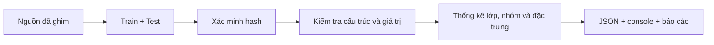
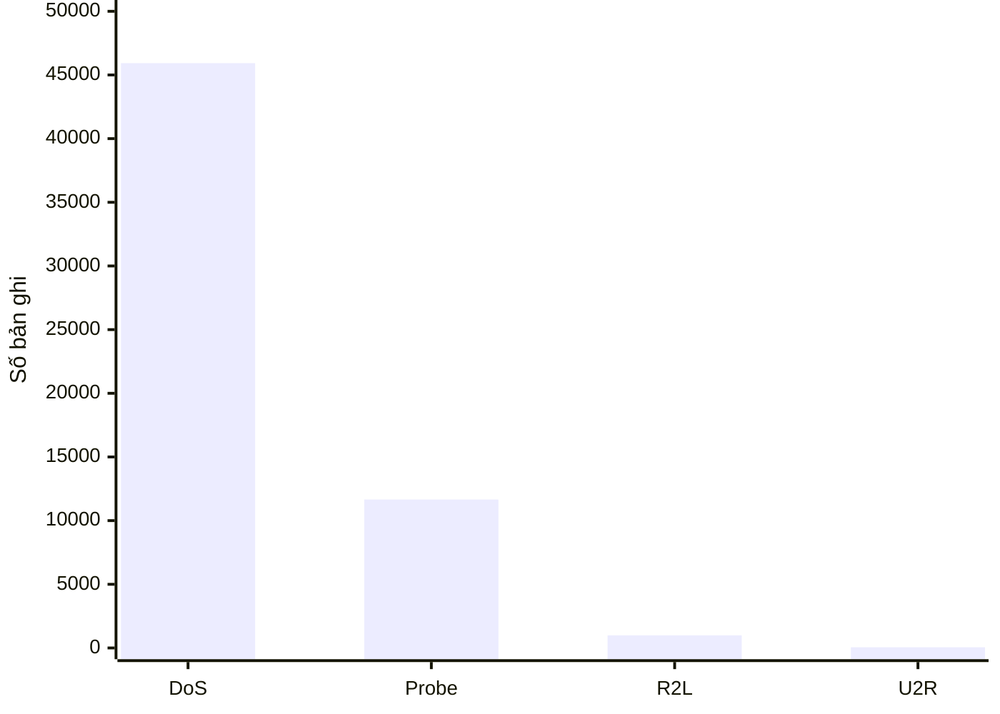
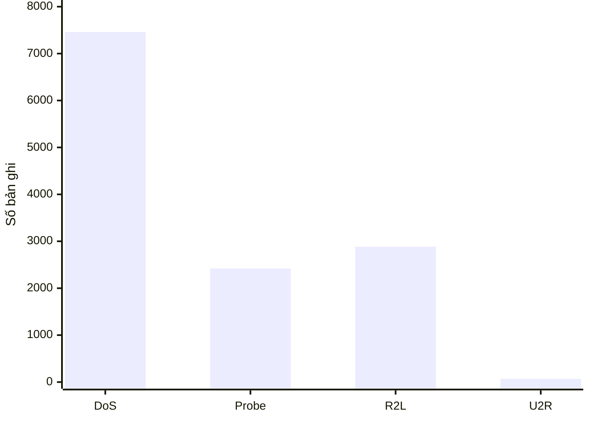

# BÁO CÁO TIẾN ĐỘ DỰ ÁN

## PHÁT HIỆN VÀ CHẤM ĐIỂM RỦI RO BẤT THƯỜNG MẠNG TRÊN NSL-KDD

| Thông tin | Nội dung |
|---|---|
| Ngày báo cáo | 05/10/2026 |
| Các giai đoạn được báo cáo | Giai đoạn 1 và Giai đoạn 2 |
| Kết quả tổng quan | Hoàn thành xác định hướng nghiên cứu và khảo sát bộ dữ liệu |

---

## TÓM TẮT

Trong hai giai đoạn đầu, dự án đã xác định Autoencoder làm phương pháp chính,
khảo sát các thuật toán đối chứng và công nghệ dự kiến; đồng thời chuẩn bị,
xác minh và kiểm tra dữ liệu NSL-KDD `KDDTrain+` và `KDDTest+`.

## GIAI ĐOẠN 1 — XÁC ĐỊNH ĐỀ TÀI, THUẬT TOÁN VÀ CÔNG NGHỆ

### 1.1. Nội dung đã thực hiện

- Xác định mục tiêu dùng Autoencoder học mẫu lưu lượng bình thường và dùng
  reconstruction error để chấm điểm bất thường.
- Xác định các nhóm cần khảo sát: bình thường, DoS, Probe, R2L và U2R.
- Xác định các thuật toán đối chứng và tiêu chí đánh giá dự kiến.
- Tìm hiểu vai trò và nguyên lý của các thuật toán trong đề tài.
- Xác định công nghệ dự kiến cho xử lý dữ liệu, mô hình và trình bày kết quả.

### 1.2. Thuật toán đã tìm hiểu

| Thuật toán | Nội dung tìm hiểu | Vai trò trong đề tài |
|---|---|---|
| Autoencoder | Encoder–decoder học tái tạo đầu vào; sai số tái tạo phản ánh mức khác biệt so với dữ liệu đã học. | Phương pháp chính để tạo điểm bất thường. |
| Isolation Forest | Dùng các phép phân hoạch ngẫu nhiên; mẫu bị cô lập nhanh thường được xem là bất thường. | Baseline phát hiện bất thường. |
| One-Class SVM | Học biên bao quanh vùng dữ liệu bình thường; mẫu ngoài biên được xem là bất thường. | Baseline one-class. |
| Random Forest | Kết hợp nhiều cây quyết định học từ dữ liệu có nhãn. | Baseline phân loại có giám sát. |

### 1.3. Công nghệ đã khảo sát

| Công nghệ | Vai trò đã xác định |
|---|---|
| Python | Viết công cụ khảo sát và triển khai pipeline. |
| pandas / NumPy | Đọc, biểu diễn và biến đổi dữ liệu dạng bảng/số. |
| scikit-learn | Tiền xử lý, Isolation Forest, One-Class SVM, Random Forest và chỉ số đánh giá. |
| PyTorch | Xây dựng và huấn luyện Autoencoder. |
| Mermaid | Vẽ sơ đồ và biểu đồ trực tiếp trong tài liệu Markdown, không cần tạo ảnh riêng. |

### 1.4. Quy ước thực nghiệm đã xác định

- Dùng 41 đặc trưng làm đầu vào; không đưa nhãn và trường difficulty vào mô
  hình.
- Giữ `KDDTest+` riêng cho đánh giá cuối; validation được tách từ train.
- Sai số tái tạo là điểm bất thường, không diễn giải như xác suất tấn công.
- So sánh dự kiến dùng PR-AUC, Recall, FPR, Macro-F1, ROC-AUC, confusion
  matrix và chỉ số theo nhóm tấn công.
- Random Forest được xác định là baseline có giám sát; các baseline còn lại
  được xem xét theo hướng phát hiện bất thường.

## GIAI ĐOẠN 2 — CHUẨN BỊ VÀ KHẢO SÁT DỮ LIỆU NSL-KDD

### 2.1. Mục tiêu và phạm vi công việc

Mục tiêu của giai đoạn này là xác nhận bộ dữ liệu có thể dùng cho thực nghiệm
và hiểu rõ cấu trúc, nhãn, phân bố mẫu trước khi thiết kế bước tiền xử lý.
Phần việc tập trung vào thu thập, xác minh nguồn, kiểm tra chất lượng và mô
tả dữ liệu; **chưa** mã hóa, chuẩn hóa hoặc huấn luyện mô hình.

### 2.2. Luồng công việc đã thực hiện

| Bước | Công việc | Mục đích |
|---|---|---|
| 1. Chọn và cố định nguồn | Sử dụng mirror công khai NSL-KDD đã ghim ở một commit cụ thể. | Giúp lần chạy sau dùng cùng phiên bản dữ liệu. |
| 2. Chuẩn bị hai tập | Đặt `KDDTrain+` và `KDDTest+` vào `data/raw/`; giữ nguyên tệp gốc. | Tách dữ liệu đầu vào khỏi mã và báo cáo; tránh ghi đè dữ liệu gốc. |
| 3. Xác minh tính toàn vẹn | Tính Git blob SHA-1 rồi đối chiếu với hash đã biết của từng tệp. | Phát hiện tệp khác phiên bản hoặc bị thay đổi. |
| 4. Kiểm tra cấu trúc | Đọc từng dòng như CSV, kiểm tra đủ 43 trường, ô trống và dòng trùng. | Xác nhận định dạng có thể phân tích nhất quán. |
| 5. Kiểm tra nội dung | Kiểm tra giá trị số, thu thập giá trị danh mục và đọc nhãn. | Tìm dữ liệu không hợp lệ và hiểu miền giá trị. |
| 6. Gom nhóm nhãn | Chuẩn hóa tên nhãn và ánh xạ tấn công thành DoS, Probe, R2L, U2R. | Có thể thống kê và đánh giá theo nhóm thay vì từng tên tấn công riêng. |
| 7. Tổng hợp kết quả | Ghi profile JSON và in bảng/thanh trực quan trong console. | Lưu được kết quả để kiểm tra lại, đồng thời giúp người dùng đọc nhanh. |

Luồng có thể tóm tắt như sau:

### 2.3. Dữ liệu và cách hiểu các trường

| Tập dữ liệu | Số bản ghi | Bình thường | Tấn công | Số trường mỗi bản ghi |
|---|---:|---:|---:|---:|
| `KDDTrain+` | 125.973 | 67.343 (53,5%) | 58.630 (46,5%) | 43 |
| `KDDTest+` | 22.544 | 9.711 (43,1%) | 12.833 (56,9%) | 43 |

Mỗi bản ghi gồm **41 đặc trưng + `label` + `difficulty`**. Các đặc trưng
`protocol_type`, `service`, `flag` là dạng danh mục; các đặc trưng còn lại là
dạng số theo schema đã khảo sát.

- 41 đặc trưng mô tả thuộc tính kết nối và thống kê lưu lượng; đây là phần
  được dự kiến đưa vào mô hình.
- `label` cho biết kết nối bình thường hay tên kiểu tấn công; nó là đáp án
  tham chiếu để phân tích/đánh giá, không phải đầu vào mô hình.
- `difficulty` là trường độ khó phân loại gắn với mẫu trong NSL-KDD; không
  phải độ nguy hiểm của tấn công hay điểm rủi ro của Autoencoder, vì vậy
  không được đưa vào đầu vào mô hình.

`KDDTrain+` và `KDDTest+` là hai tập được cung cấp sẵn cùng bộ dữ liệu. Trong
quy ước nghiên cứu, test được giữ riêng cho đánh giá cuối; không dùng nó để
fit phép biến đổi hoặc chọn ngưỡng.

### 2.4. Kết quả xác minh và kiểm tra chất lượng

| Hạng mục kiểm tra | KDDTrain+ | KDDTest+ |
|---|---:|---:|
| Git blob SHA-1 khớp nguồn đã ghim | Có | Có |
| Dòng có đúng 43 trường | 125.973/125.973 | 22.544/22.544 |
| Dòng sai định dạng | 0 | 0 |
| Ô trống | 0 | 0 |
| Dòng trùng | 0 | 0 |
| Ô số không hợp lệ | 0 | 0 |
| Nhãn chưa ánh xạ | 0 | 0 |

Các kết quả này cho thấy tệp có thể được đọc nhất quán theo schema đã khai
báo. Đây là kiểm tra cấu trúc và hợp lệ cơ bản; không có nghĩa mọi thuộc tính
của dữ liệu đều đại diện đầy đủ cho lưu lượng mạng hiện đại.

### 2.5. Phân bố nhóm tấn công và diễn giải

| Nhóm | Train | Test |
|---|---:|---:|
| DoS | 45.927 | 7.460 |
| Probe | 11.656 | 2.421 |
| R2L | 995 | 2.885 |
| U2R | 52 | 67 |

**Train — số mẫu theo nhóm**

**Test — số mẫu theo nhóm**

Phân bố cho thấy dữ liệu mất cân bằng giữa các nhóm: DoS chiếm phần lớn,
trong khi U2R có rất ít mẫu; R2L cũng ít hơn đáng kể so với DoS/Probe trong
train. Vì vậy, ở các giai đoạn đánh giá cần trình bày số mẫu hỗ trợ của từng
nhóm, không kết luận chỉ từ accuracy, và không cân bằng lại tập test.

### 2.6. Khảo sát đặc trưng danh mục

| Đặc trưng | Số loại trong train | Số loại trong test |
|---|---:|---:|
| `protocol_type` | 3 | 3 |
| `service` | 70 | 64 |
| `flag` | 11 | 11 |

Đã đối chiếu giá trị thực tế và không phát hiện category trong test vắng mặt
ở train. Dù vậy, khi xây dựng pipeline vẫn cần cấu hình cách xử lý category
chưa biết để tránh lỗi nếu gặp dữ liệu mới ngoài hai tệp benchmark.

### 2.7. Công cụ và sản phẩm của giai đoạn

- [Công cụ `inspect_nsl_kdd.py`](../scripts/inspect_nsl_kdd.py) thực hiện
  tải/xác minh tệp theo yêu cầu, đọc từng dòng, thống kê và in kết quả.
- [Profile JSON](../reports/nsl_kdd_data_profile.json) lưu số lượng mẫu,
  phân bố nhãn, nhóm tấn công, lỗi dữ liệu, cardinality và min/max.
- [Tài liệu khảo sát dữ liệu](./02-khao-sat-du-lieu.md) trình bày nguồn, quy
  trình, schema, kết quả và lưu ý sử dụng.
- [Bộ kiểm thử](../tests/test_inspect_nsl_kdd.py) kiểm tra ánh xạ nhãn, nhận
  diện nhãn chưa biết, thống kê lỗi trên dữ liệu mẫu và phần hiển thị console.
- Các biểu đồ thanh trong terminal là ký tự `#`; sơ đồ Mermaid trong báo cáo
  hiển thị trong Markdown Preview tương thích. Công cụ không tạo ảnh SVG/PNG.

### 2.8. Lưu ý và ranh giới kết quả

1. Giữ nguyên hai tệp trong `data/raw/`; profile và dữ liệu phát sinh không
   ghi đè dữ liệu nguồn.
2. Hash khớp chứng minh tính toàn vẹn so với phiên bản đã ghim, không chứng
   minh bộ dữ liệu đại diện cho mọi mạng thực tế.
3. Không đưa `label` hoặc `difficulty` vào mô hình; chỉ 41 đặc trưng được
   xem xét làm đầu vào.
4. Không dùng `KDDTest+` để chọn encoder, scaler, cấu hình mô hình hay ngưỡng.
5. Giai đoạn này chưa tách validation, chưa mã hóa/chuẩn hóa dữ liệu và chưa
   huấn luyện Autoencoder hoặc baseline. Các việc đó không được tính là kết
   quả đã hoàn thành ở đây.

**Đánh giá tiến độ:** phần chuẩn bị, xác minh và khảo sát dữ liệu của Giai
đoạn 2 đã hoàn thành; kết quả hiện có đủ để chuyển sang thiết kế pipeline
tiền xử lý mà vẫn giữ nguyên test độc lập.

## SẢN PHẨM ĐÃ HOÀN THÀNH

| Sản phẩm | Tệp |
|---|---|
| Đặc tả phạm vi, tiêu chí, thuật toán và công nghệ | [01-pham-vi-va-tieu-chi.md](./01-pham-vi-va-tieu-chi.md) |
| Tài liệu chuẩn bị và khảo sát NSL-KDD | [02-khao-sat-du-lieu.md](./02-khao-sat-du-lieu.md) |
| Profile dữ liệu dạng JSON | [nsl_kdd_data_profile.json](../reports/nsl_kdd_data_profile.json) |
| Script khảo sát và hiển thị kết quả trong console | [inspect_nsl_kdd.py](../scripts/inspect_nsl_kdd.py) |
| Hướng dẫn cấu trúc và sử dụng dự án | [README.md](../README.md) |

**Kiểm thử công cụ khảo sát:** 4/4 kiểm thử đạt.
