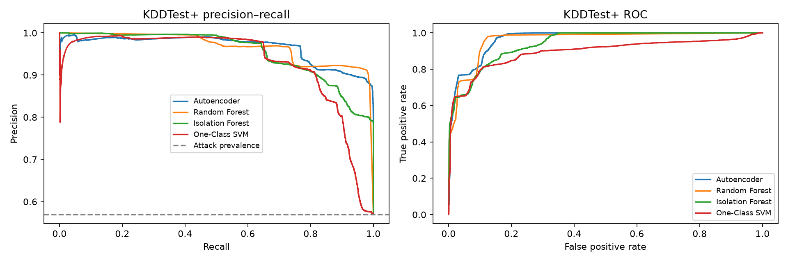

# So sánh bốn mô hình trên KDDTest+

Đánh giá trên cùng **22,544 mẫu**, gồm 12,833 Attack. Attack=1; score càng cao càng bất thường. Mọi ngưỡng được chốt bằng validation, không chọn hoặc điều chỉnh bằng test.

| Mô hình | Giả định học | Accuracy | Precision Attack | Recall Attack | F1 Attack | Macro-F1 | FPR | PR-AUC (AP) | ROC-AUC |
|---|---|---:|---:|---:|---:|---:|---:|---:|---:|
| Autoencoder | Normal-only | 74.83% | 98.03% | 56.93% | 72.03% | 74.58% | 1.51% | 0.9662 | 0.9646 |
| Random Forest | Có giám sát | 80.71% | 96.94% | 68.27% | 80.12% | 80.69% | 2.85% | 0.9640 | 0.9604 |
| Isolation Forest | Normal-only | 74.25% | 98.11% | 55.84% | 71.17% | 73.95% | 1.42% | 0.9539 | 0.9412 |
| One-Class SVM | Normal-only | 70.36% | 98.92% | 48.45% | 65.05% | 69.66% | 0.70% | 0.9296 | 0.8943 |

## Cách đọc và giới hạn so sánh

- Random Forest được dùng nhãn Normal/Attack của toàn bộ phần train. Ba mô hình còn lại chỉ dùng Normal để học trọng số/cấu trúc. Không xem đây là so sánh cùng giả định học.
- Cùng 77 đặc trưng từ pipeline fit trên Normal train. Không fit lại preprocessing trên test.
- Autoencoder giữ nguyên latent dimension và threshold đã tối ưu. Không huấn luyện lại hoặc chọn lại bằng kết quả của ba baseline.
- Cùng Normal calibration và validation selection với Autoencoder: 4040 và 7559 mẫu tương ứng. Các ngưỡng P97/P98/P99/P99.5/P99.9 tính từ Normal calibration; chọn macro-F1 selection cao nhất với FPR<=1%. Nếu không có ứng viên đạt, chọn FPR thấp nhất và báo constraint không đạt.
- Nhãn Attack validation có dùng để chọn threshold; huấn luyện IF/OCSVM/AE vẫn là Normal-only. Ngân sách FPR validation không bảo đảm FPR test <=1%.
- PR-AUC báo theo average precision từ score liên tục gốc. F1, recall, FPR phụ thuộc threshold. Không so giá trị score hoặc threshold tuyệt đối giữa các mô hình.
- Baseline dùng cấu hình định trước, chưa có tìm kiếm siêu tham số đa cấu hình. AE đã được thử latent 8/16/32, nên ngân sách tối ưu chưa bằng nhau. Một seed, một benchmark không chứng minh ưu thế tổng quát.
- Test đã được xem ở các giai đoạn trước. Lần so sánh này cố định tất cả cấu hình/ngưỡng trước khi tính test; chưa có tập đánh giá ngoài NSL-KDD.

## Ngưỡng và cấu hình

| Mô hình | Mẫu huấn luyện | Threshold | FPR selection <=1% đạt? |
|---|---:|---:|---|
| Autoencoder | 53874 | 0.10899014 | Có |
| Random Forest | 100778 | 0.36614667 | Có |
| Isolation Forest | 53874 | 0.52580737 | Có |
| One-Class SVM | 53874 | 65.434201 | Có |

- RF: 300 cây, class_weight=balanced, seed 42, n_jobs=4.
- IF: 300 cây, max_samples=256/cây, fit trên toàn bộ Normal train, seed 42. Score = -score_samples; không dùng offset contamination để chọn ngưỡng.
- OCSVM: RBF, gamma=scale, nu=0.05, cache_size=1024 MB, không giới hạn số iteration. Fit toàn bộ Normal train, không lấy mẫu con. Score = -decision_function; có thể âm.
- AE: checkpoint tối ưu latent 16 hiện có; score = reconstruction MSE.

## Recall theo nhóm tấn công và cảnh báo nhầm

| Mô hình | DoS | Probe | R2L | U2R | FPR Normal |
|---|---:|---:|---:|---:|---:|
| Autoencoder | 69.72% | 64.81% | 17.16% | 61.19% | 1.51% |
| Random Forest | 85.47% | 87.28% | 8.94% | 20.90% | 2.85% |
| Isolation Forest | 69.62% | 79.43% | 1.39% | 13.43% | 1.42% |
| One-Class SVM | 58.63% | 52.25% | 18.65% | 61.19% | 0.70% |

Các tỷ lệ trên dùng cùng số mẫu hỗ trợ theo nhóm. Nhóm U2R nhỏ; không nên kết luận chắc chắn từ tỷ lệ của một nhóm ít mẫu.

## Confusion matrix

Hàng là nhãn thật, cột là dự đoán, thứ tự `[Normal, Attack]`.

- Autoencoder: `[[9564, 147], [5527, 7306]]`.
- Random Forest: `[[9434, 277], [4072, 8761]]`.
- Isolation Forest: `[[9573, 138], [5667, 7166]]`.
- One-Class SVM: `[[9643, 68], [6615, 6218]]`.

## Nhận xét từ kết quả

- PR-AUC cao nhất trong lần chạy: **Autoencoder**, 0.9662.
- macro-F1 cao nhất trong lần chạy: **Random Forest**, 0.8069.
- recall Attack cao nhất trong lần chạy: **Random Forest**, 0.6827.
- FPR thấp nhất: **One-Class SVM**, 0.70%.

Các nhận xét là mô tả test, không dùng để chọn lại cấu hình hoặc ngưỡng. Cần đọc đồng thời recall và FPR, đặc biệt khi so sánh RF có giám sát với mô hình Normal-only.

## Biểu đồ và file

- [Bảng CSV bốn mô hình](comparison.csv)
- [Toàn bộ metrics, cấu hình và hash dữ liệu](metrics.json)
- [Phân tích threshold validation](validation_thresholds.csv)
- [Tỷ lệ phát hiện theo nhóm và số mẫu hỗ trợ](group_detection.csv)
- [Hướng dẫn chạy lại](../../docs/06-model-comparison.md)
