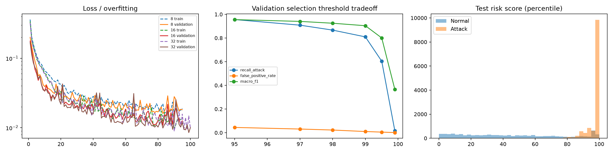

# Kết quả risk scoring và tối ưu

## So sánh latent dimension trên validation selection

| Latent | Epoch tốt nhất / thực chạy | MSE train | MSE early stopping | AP selection |
|---|---:|---:|---:|---:|
| 8 | 83 / 95 | 0.014657 | 0.016018 | 0.972914 |
| 16 | 83 / 95 | 0.013380 | 0.010880 | 0.978826 |
| 32 | 99 / 100 | 0.007908 | 0.008520 | 0.978095 |

Chọn latent **16** theo AP selection cao nhất. Không chọn bằng MSE train hoặc kết quả test. Chênh lệch AP giữa 16 và 32 nhỏ; chưa có nhiều seed để xác nhận khác biệt có ý nghĩa thống kê.

## Threshold và cảnh báo

| Phân vị calibration | MSE threshold | Precision selection | Recall selection | FPR selection | Macro-F1 |
|---|---:|---:|---:|---:|---:|
| P95 | 0.023762 | 94.92% | 95.59% | 4.45% | 0.9555 |
| P97 | 0.034511 | 96.24% | 90.85% | 3.09% | 0.9403 |
| P98 | 0.047478 | 97.10% | 86.67% | 2.25% | 0.9248 |
| P99 | 0.108990 | 98.61% | 80.96% | 0.99% | 0.9038 |
| P99.5 | 0.242000 | 99.07% | 60.40% | 0.49% | 0.8005 |
| P99.9 | 1.432394 | 93.65% | 1.68% | 0.10% | 0.3664 |

Ngưỡng High đã chọn: P99 = **0.10899014**. Ngân sách FPR selection <=1% đạt: **True**.

- Low: MSE < 0.02376216.
- Medium: 0.02376216 <= MSE < 0.10899014.
- High: MSE >= 0.10899014; tương ứng dự đoán Attack.

Điểm 0–100 là empirical CDF của Normal calibration, không phải xác suất tấn công. Mức cảnh báo dùng MSE chưa làm tròn để tránh sai ranh giới của điểm hiển thị.

P95 có recall cao hơn nhưng FPR selection vượt ngân sách. Nâng ngưỡng giảm cảnh báo nhầm và đồng thời bỏ sót thêm tấn công. Không dùng test để đổi ngưỡng.

## Overfitting

- Latent 8: MSE stop/train của checkpoint tốt nhất = 1.093; MSE stop epoch cuối cao hơn tốt nhất 13.5%. Đã khôi phục epoch 83.
- Latent 16: MSE stop/train của checkpoint tốt nhất = 0.813; MSE stop epoch cuối cao hơn tốt nhất 15.4%. Đã khôi phục epoch 83.
- Latent 32: MSE stop/train của checkpoint tốt nhất = 1.077; MSE stop epoch cuối cao hơn tốt nhất 18.1%. Đã khôi phục epoch 99.

Loss dao động và có giai đoạn validation xấu đi, nên checkpoint cuối không được chọn tự động. Không có khoảng chênh train/validation lớn ở checkpoint tốt nhất trong ba thử nghiệm; điều này chưa đủ chứng minh mô hình không overfit. Latent 32 giảm MSE nhiều hơn nhưng AP không cao nhất, cho thấy khả năng tái tạo Normal tốt hơn không tự bảo đảm phát hiện Attack tốt hơn. Cấu hình 32 chạm giới hạn 100 epoch, chưa kết luận hội tụ hoàn toàn. Chỉ chạy một seed mỗi cấu hình.

## Đánh giá test sau khi chốt cấu hình

| Chỉ số | Giá trị |
|---|---:|
| precision_attack | 0.980276 |
| recall_attack | 0.569313 |
| false_positive_rate | 0.015137 |
| f1_attack | 0.720300 |
| macro_f1 | 0.745764 |
| pr_auc_average_precision | 0.966234 |
| roc_auc | 0.964587 |

Confusion matrix (hàng thật, cột dự đoán; Normal/Attack): `[[9564, 147], [5527, 7306]]`.

| Nhóm | Số mẫu | Tỷ lệ bị gán Attack |
|---|---:|---:|
| DoS | 7460 | 69.72% |
| Probe | 2421 | 64.81% |
| R2L | 2885 | 17.16% |
| U2R | 67 | 61.19% |
| normal | 9711 | 1.51% |

Tỷ lệ gán Attack là recall đối với nhóm tấn công và FPR đối với Normal. R2L vẫn bị bỏ sót nhiều; U2R có ít mẫu. Mục tiêu FPR <=1% trên validation selection không bảo đảm trên test: FPR test thực tế = 1.51%.

## So với giai đoạn trước (chỉ mô tả)

| Chỉ số test | Trước | Tối ưu |
|---|---:|---:|
| precision_attack | 0.9865 | 0.9803 |
| recall_attack | 0.5053 | 0.5693 |
| false_positive_rate | 0.0092 | 0.0151 |
| macro_f1 | 0.7088 | 0.7458 |

Hai giai đoạn có cách chia vai trò validation khác nhau; không quy toàn bộ chênh lệch cho latent dimension. Đây là đánh đổi recall/FPR, không phải cải thiện đồng thời mọi chỉ số. Test đã được xem ở giai đoạn trước; lần tìm kiếm này không dùng test để chọn model hay threshold.

## Biểu đồ và đầu ra

- [Dự đoán test kèm risk score](test_risk_predictions.csv)
- [Phân bố mức cảnh báo theo nhóm](risk_by_group.csv)
- [Số liệu đầy đủ và giao thức](summary.json)
- [Hướng dẫn chạy](../../docs/05-risk-scoring.md)
